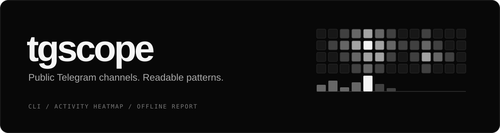

<p align="center">
  
</p>

<p align="center">
  
  
  <a href="LICENSE"></a>
</p>

<p align="center">
  Анализ публичного Telegram-канала по имени — в терминале.
</p>

<p align="center">
  <a href="#installation">Установка</a> ·
  <a href="#quick-start">Запуск</a> ·
  <a href="#usage">Команды</a> ·
  <a href="#flags">Флаги</a> ·
  <a href="#limits">Ограничения</a>
</p>

<a id="installation"></a>

## Скачать и установить

Нужны **Python 3.11+** и **Git**. Если проект уже скачан, откройте терминал в его папке и пропустите первые две команды.

### macOS / Linux

```bash
git clone https://github.com/tzr7ybdfky-dotcom/tgscope.git
cd tgscope
python3 -m venv .venv
.venv/bin/python -m pip install .
```

### Windows · PowerShell

```powershell
git clone https://github.com/tzr7ybdfky-dotcom/tgscope.git
cd tgscope
py -3 -m venv .venv
.\.venv\Scripts\python.exe -m pip install .
```

<a id="quick-start"></a>

## Открыть терминал и запустить

- **macOS:** откройте «Терминал» через Spotlight (`⌘ + пробел`). Введите `cd `, перетащите папку проекта в окно и нажмите Enter.
- **Linux:** откройте папку проекта в файловом менеджере → правая кнопка мыши → «Открыть в терминале».
- **Windows:** откройте папку проекта в Проводнике, в адресной строке введите `powershell` и нажмите Enter.

Активируйте окружение в открытом терминале:

**macOS / Linux:**

```bash
source .venv/bin/activate
```

**Windows · PowerShell:**

```powershell
.\.venv\Scripts\Activate.ps1
```

Если PowerShell запрещает запуск скрипта, выполните `Set-ExecutionPolicy -Scope Process -ExecutionPolicy Bypass` и повторите активацию. Настройка действует только в текущем окне.

Теперь запускайте анализ:

```bash
tgscope CHANNEL
```

Замените `CHANNEL` на имя канала без `@`. Подходят и `@CHANNEL`, и ссылка `https://t.me/CHANNEL`.
В новом окне терминала снова активируйте окружение. Остановить загрузку — **Ctrl+C**.

## Обновить программу

```bash
git pull --ff-only
.venv/bin/python -m pip install .
```

На Windows вторая команда — `.\.venv\Scripts\python.exe -m pip install .`

## Что умеет tgscope

- **Когда пишет:** карта активности «день недели × час» в выбранном часовом поясе.
- **Часовой пояс автора:** гипотеза по самому тихому пятичасовому окну.
- **Связи с каналами:** откуда репостит и кого упоминает — `@имена` и ссылки `t.me`.
- **Куда ведёт трафик:** домены из ссылок и превью.
- **Пропуски в нумерации:** удалённые посты, служебные сообщения или альбомы.
- **Остальное:** самые просматриваемые посты, хэштеги, подписи авторов, долгие паузы, правки.
- **Автономный HTML:** отчёт открывается без интернета, светлая и тёмная тема.

Данные берутся из публичной веб-версии `t.me/s/<канал>`. Аккаунт Telegram, API-ключи и вход не нужны.

> Часовой пояс автора — гипотеза, а не факт. Отложенные посты, команда авторов
> и ночные публикации её ломают. Числа описывают только загруженную выборку.

<a id="usage"></a>

## Использование

**Сводка в терминале:**

```bash
tgscope CHANNEL
```

Во время загрузки показывается счётчик постов. После — сводка: подписчики, период,
активность по часам, репосты, упоминания, домены, топ постов и раздел «Что видно».

**Часовой пояс, отчёт и выборка:**

```bash
tgscope CHANNEL --tz Europe/Moscow
tgscope CHANNEL --tz +3 --out
tgscope CHANNEL --out report.html --no-open
tgscope CHANNEL -n 1000 --since 90d
tgscope CHANNEL --json data.json
tgscope --help
```

`--out` без имени файла сохраняет отчёт в `reports/CHANNEL.html` и открывает его в браузере.
`--json` сохраняет всё, включая тексты постов, — для своих скриптов и таблиц.

<a id="flags"></a>

## Флаги

| Флаг | Поведение |
|---|---|
| `-n 500`, `--limit 500` | Сколько последних постов загрузить. По умолчанию 300. |
| `--since 30d` | Не раньше даты: `2026-01-31` или число дней `30d`. |
| `--tz +3` | Часовой пояс карты: `+3`, `UTC-5`, `Europe/Moscow`. По умолчанию UTC. |
| `-o`, `--out [ФАЙЛ]` | Сохранить HTML-отчёт. Без имени — `reports/CHANNEL.html`. `--html` — то же самое. |
| `--no-open` | Не открывать HTML в браузере после сохранения. |
| `--json ФАЙЛ` | Сохранить все данные в JSON. |
| `--delay 1.5` | Пауза между запросами к t.me. По умолчанию 1 с, минимум 0,3 с. |
| `--timeout 30` | Сетевой таймаут. По умолчанию 20 с. |
| `--version` | Версия программы. |

Одна страница веб-версии — около 20 постов, поэтому 300 постов — это ~15 запросов.
На HTTP 429 программа ждёт столько, сколько просит Telegram.

**Коды выхода:** `0` — готово, `1` — канал недоступен или пуст, `2` — сетевая ошибка, `130` — остановлено.

<a id="limits"></a>

## Ограничения и данные

- Работают только каналы с включённой публичной веб-версией. Закрытые каналы, группы
  и личные аккаунты недоступны — так задумано.
- Пропуск в номерах не доказывает удаление: фото одного альбома и служебные сообщения
  тоже занимают номера.
- Скрытый источник репоста (`скрытый источник`) — автор оригинала запретил ссылку на себя.
- CAPTCHA и ограничения не обходятся.

Отчёты сохраняются только на ваш компьютер. Папка `reports/` и файлы `*.json` занесены
в `.gitignore` и не попадут в репозиторий. Не используйте результаты для преследования
или обвинений.

## Разработка

```bash
.venv/bin/python -m pip install '.[dev]'
.venv/bin/python -m pytest
.venv/bin/ruff check .
```

Тесты используют выдуманные фикстуры и запрещают сеть.

> На macOS с Python 3.13+ `pip install -e .` в папке на Рабочем столе может не работать:
> система помечает служебный `.pth`-файл скрытым, и Python его пропускает.
> Используйте обычную установку `pip install .` и переустанавливайте после правок.

## Лицензия

[MIT](LICENSE) · tgscope contributors.
